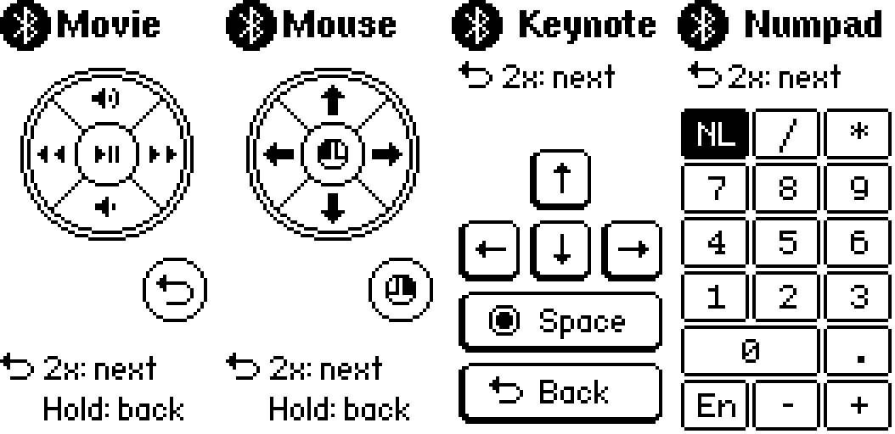
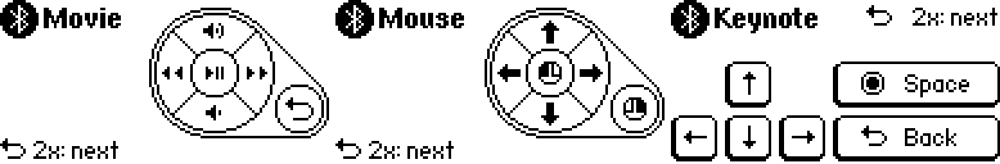

# Media Combo and Keys Combo (Flipper Zero)

Two Flipper Zero remotes that keep several HID modes in one app and change
between them with the Back button, without going through the menu.

| App | Modes, in ring order | Starts in, swap partner |
|---|---|---|
| Media Combo | Movie, Mouse | Movie, Mouse |
| Keys Combo | Mouse, Keynote, Keyboard, Numpad | Mouse, Keynote |

Each is built for Bluetooth and USB from the same source:

| App file | Flipper menu | Link |
|---|---|---|
| `media_combo_ble.fap` | Apps → Bluetooth → Media Combo | Bluetooth LE |
| `media_combo_usb.fap` | Apps → USB → Media Combo | USB cable |
| `keys_combo_ble.fap` | Apps → Bluetooth → Keys Combo | Bluetooth LE |
| `keys_combo_usb.fap` | Apps → USB → Keys Combo | USB cable |

The PC sees a standard keyboard, mouse and media device. Nothing is installed
on the PC. Until version 1.6 both apps were one app called Remote Combo.

## Controls

| Gesture | Effect |
|---|---|
| Double tap Back | Next mode in ring order (short vibration) |
| Hold Back about 0.3 s, release | Swap back to the mode shown before (short vibration) |
| Keep holding Back about 1.5 s | Open the mode menu |
| Back in the mode menu | Leave the app |

A single short Back press keeps its meaning inside each mode: right click in
Mouse, Backspace in Keyboard and Numpad, Backspace and Back in Keynote. It is
sent about 0.35 s late, because the app first waits for a possible second tap.

### Mouse

The Mouse mode uses the motion engine of
[Better Mouse](https://github.com/Timon-sys/Bettermouse) by timon: a fixed-rate
motion loop with smooth acceleration, true diagonals and an optional Ice mode.

| Key | Effect |
|---|---|
| Arrows | Move the pointer, or scroll in scroll mode |
| OK | Left click |
| Hold OK | Next state: pointer → scroll → drag (left button held) → pointer |
| OK while dragging | Drop the drag, back to pointer |
| Back | Right click |

The menu entry **Mouse settings** sets speed, ramp, scroll speed, report rate,
Ice mode, inverted axes and click vibration. The settings are shared by all
four apps (`/ext/apps_data/remote_combo/mouse.settings`); on first start they
are taken over from the Better Mouse app, if it is installed.

### Keyboard

The full keyboard of the stock Remote app: arrows move the cursor, OK types
the key (Shift, Ctrl, Alt and Cmd toggle), Back is Backspace.

## Layout

The menu entry **Layout: Horizontal / Upright** turns the modes for holding the
Flipper upright, and turns the arrow keys with them. The choice is stored on
the SD card (`/ext/apps_data/<appid>/orientation`). Numpad has an upright
screen only and Keyboard a horizontal one; both ignore the setting. The mode menu itself is always horizontal.

The screenshots below are from version 1.4 (before the split and the new
Mouse screen).





## Build and install

Needs [ufbt](https://github.com/flipperdevices/flipperzero-ufbt). The SDK must
match the firmware on the Flipper (checked with official firmware 1.5.1,
API 88.2).

```bash
ufbt update --channel=release
```

```bash
ufbt
```

The `.fap` files land in `dist/`. Copy them to the SD card (`/ext/apps/Bluetooth/` and `/ext/apps/USB/`) with
qFlipper or lab.flipper.net, or, with the Flipper on USB and no other app using
its port:

```bash
ufbt launch APPID=media_combo_ble
```

## Bluetooth pairing

Both apps use the pairing keys of the stock Remote app
(`/ext/apps_data/hid_ble/.bt_hid.keys`) and the same Bluetooth name and
address. A PC paired with the stock Remote app connects to Media Combo and
Keys Combo without pairing again, and the other way round.

## Credits

This project is a fork and combination of these GPL-3.0 projects:

| Project | What came from it |
|---|---|
| [Flipper Zero firmware](https://github.com/flipperdevices/flipperzero-firmware) (Remote app, `applications/system/hid_app`, firmware 1.5.1) | the app base, Bluetooth/USB transport, Keyboard view |
| [Unleashed firmware](https://github.com/DarkFlippers/unleashed-firmware) (its Remote app) | Movie and Numpad views, other views, icons |
| [Better Mouse](https://github.com/Timon-sys/Bettermouse) 1.2 by timon | Mouse motion engine and its settings |
| [ufbt](https://github.com/flipperdevices/flipperzero-ufbt) | build tool |

Changes against the originals: split into two apps with their own mode lists,
next mode on a double tap of Back, swap on long Back (`hid_mode_*` in `hid.c`),
menu on a longer hold, the app starts directly in a mode, upright screens for
Movie, Mouse and Keynote, pairing keys shared with the stock app.

Not affiliated with or endorsed by Flipper Devices.

## AI use

Large parts of this project were written with AI coding assistants. I review
the changes and test them on my own Flipper Zero with Bluetooth and USB, but
treat the code like any third-party code: read it before you rely on it. It
comes without warranty (see LICENSE). Commits written with an assistant carry a
`Co-Authored-By` line.

## Licence

GPL-3.0 (see `LICENSE`), as required by the projects it is based on.
